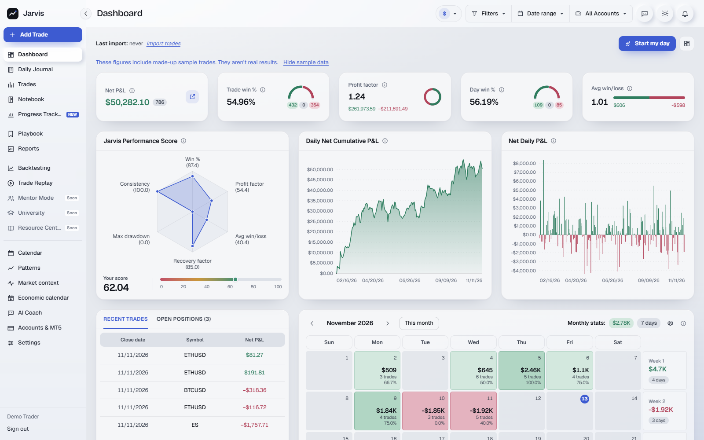
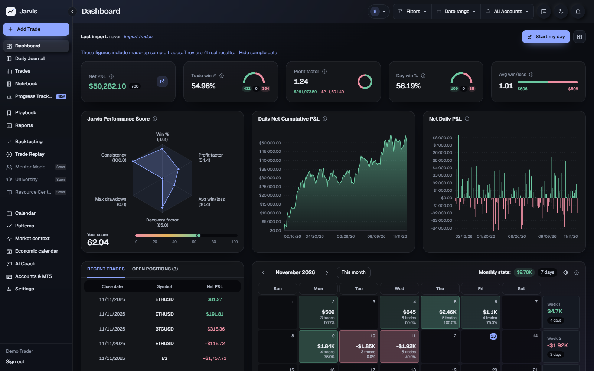
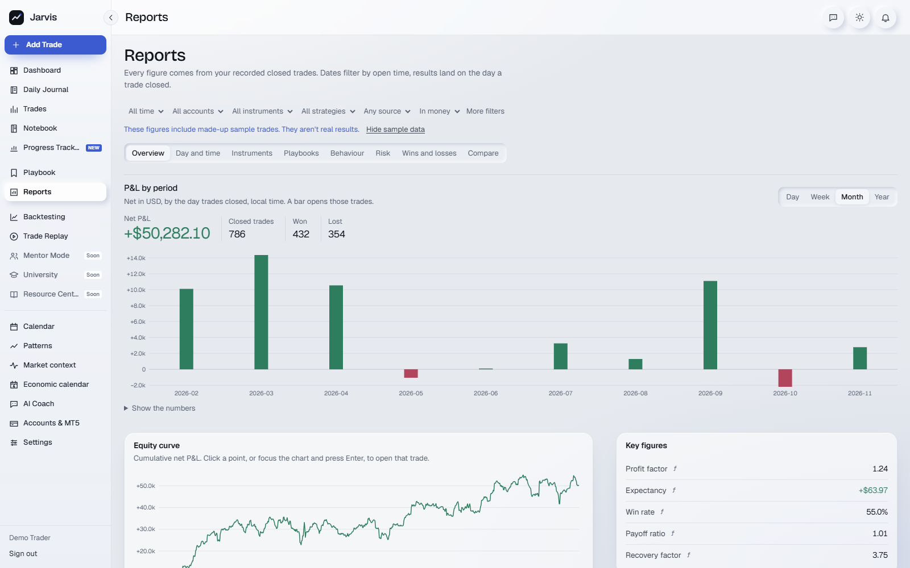
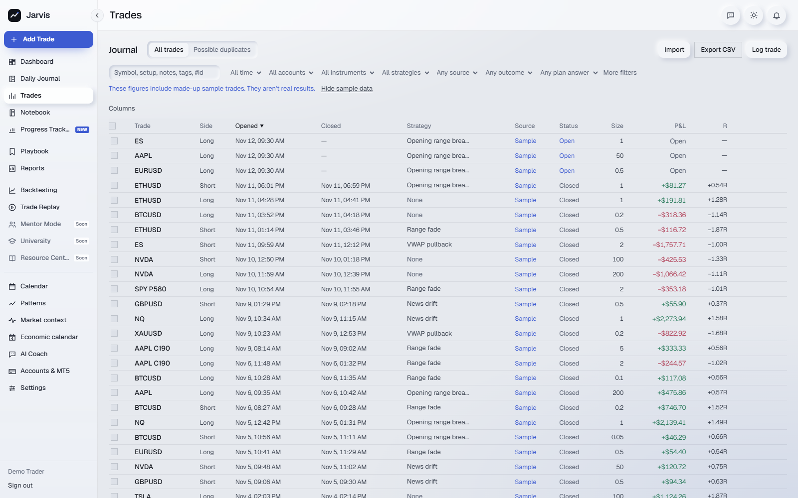
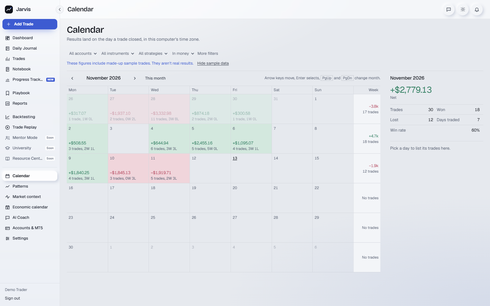

# Jarvis — Trading Journal

A private, local-first trading journal and performance platform for MetaTrader 5 traders.
Jarvis gathers every trade into one record (MT5 sync, file import or manual entry), computes
honest statistics from it, and gives the trader the tools to review, plan and improve:
analytics, a P&L calendar, playbooks, a notebook, backtesting, trade replay, prop-challenge
tracking and an AI coach that works only from the trader's own records.

Everything runs on the trader's own computer. There is no cloud service and no external
database; the journal lives in a single SQLite file.



<details>
<summary>More screens</summary>

| | |
|---|---|
|  |  |
|  |  |

</details>

## Features

**Journal**
- Trade log with sortable columns, saved views, bulk actions and CSV export
- Import from CSV or Excel with column mapping, explicit number and date formats, and duplicate detection
- Read-only MetaTrader 5 sync through a broker-issued investor login
- Daily journal, notebook with folders, templates, links and version history, and attachments

**Analysis**
- Dashboard with KPI cards, cumulative P&L, a month calendar and a 0–100 performance score
- Reports: wins and losses, risk, R-multiples, MAE / MFE, and side-by-side comparisons
- Behavioural pattern detection with sample-size gates and linked evidence
- Price charts with trade markers, plus trade and day replay

**Process**
- Playbooks with rules, checklists, adherence tracking and missed trades
- Backtesting sessions on historical broker prices
- Prop-firm challenge tracking with rule-breach alerts
- Routines, streaks, goals, spending, economic calendar and periodic reviews

**AI coach**
- Reflective coaching chat grounded in the trader's own statistics, citing trades as `[#id]`
- Pluggable model providers (Anthropic, plus an offline demo mode) with model discovery and in-chat switching
- User-controlled memory and a privacy setting that decides exactly what is shared with a provider
- Never gives buy or sell instructions and never places trades

## Tech stack

| Layer | Technology |
|---|---|
| Framework | Next.js 16 (App Router), React 19, TypeScript |
| Styling | Tailwind CSS v4 with a token-based design system, light and dark themes |
| Data | SQLite through Node's built-in `node:sqlite`, versioned migrations |
| Validation | Zod at every API boundary |
| Charts | Lightweight Charts, custom SVG charts |
| AI | Anthropic SDK behind a provider interface |
| Broker | Python service using the `MetaTrader5` package (read-only) |
| Marketing site | GSAP, Lenis, Motion, Three.js / React Three Fiber |
| Testing | Node test runner (unit and integration), Playwright (end-to-end) |

## Architecture

```
src/
  app/                  pages (App Router) and api/ route handlers
  components/           UI: shell, design-system primitives, dashboard, charts, journal, coach
  lib/domain/           pure logic: types, P&L and R maths, metrics, patterns, score
  lib/server/           database, migrations, repositories, auth, import, backups
  lib/server/ai/        provider interface, registry, context builder, prompts
  lib/server/mt5/       MT5 client, encrypted credential storage, sync
services/mt5/           read-only Python bridge to a dedicated MT5 terminal
e2e/                    Playwright end-to-end tests
```

- **Derived, not stored.** P&L, R and every statistic are computed on read from the raw
  executions, so a corrected trade updates every figure at once.
- **Unknown stays unknown.** Missing fees, stops or prices are kept as `null` and flagged,
  never turned into zero. The rules for awkward cases are in [`docs/TRADING_CONVENTIONS.md`](docs/TRADING_CONVENTIONS.md),
  and the performance score is documented in [`docs/performance-score.md`](docs/performance-score.md).
- **Currencies are never mixed.** Totals cover one account currency at a time.
- **Providers are swappable.** AI and market data sit behind interfaces
  (`src/lib/server/ai/types.ts`, `src/lib/server/market/types.ts`); adding one needs no UI changes.

## Security and privacy

- Local accounts with scrypt-hashed passwords, constant-time comparison, a login rate limit
  and one-time recovery codes
- Per-user data isolation on every query, verified by cross-user end-to-end tests
- HTTP-only, same-site session cookies; a strict Content-Security-Policy; requests from other
  sites and non-loopback hosts are refused before any route runs
- MT5 investor passwords encrypted with AES-256-GCM, with the key stored apart from the database
- The MT5 bridge contains no trading calls and only ever attaches to its own dedicated terminal
- API keys stay on the server; chat content and notes are never logged

## Getting started

Requirements: Node.js 24.22.1+ (for `node:sqlite`) and npm. MT5 sync additionally needs
Windows, Python 3 and the `MetaTrader5` package.

```bash
npm install
cp .env.example .env.local   # optional: add ANTHROPIC_API_KEY for the AI coach
npm run dev                  # http://127.0.0.1:3000
```

Production build: `npm run build && npm start`. The first account created owns the
installation; a sample journal can be loaded from the dashboard and removed in Settings.

## Testing

```bash
npm run lint
npx tsc --noEmit
npm test            # unit and integration tests
npm run test:e2e    # Playwright end-to-end suite (isolated build and throwaway database)
```

The end-to-end suite covers the main journeys, responsive layouts from 320 px to 1920 px,
and security: every API route rejects missing, forged and revoked sessions, and one user
can never read or change another user's data.

## Disclaimer

Jarvis is a journaling and education tool. It does not place trades and does not provide
financial, investment or psychological advice.
